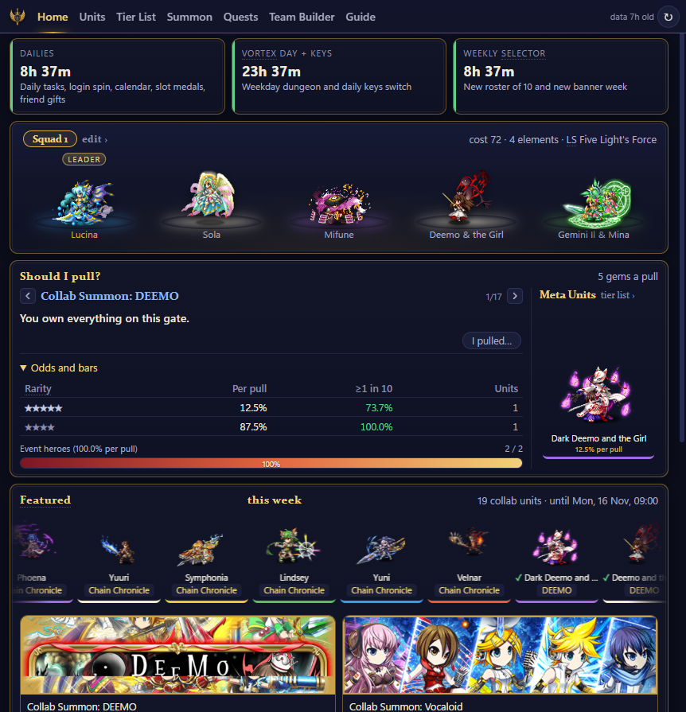
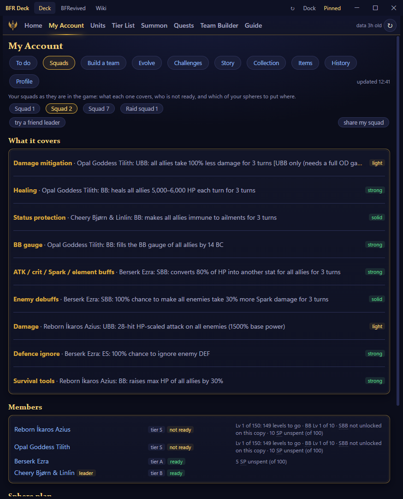
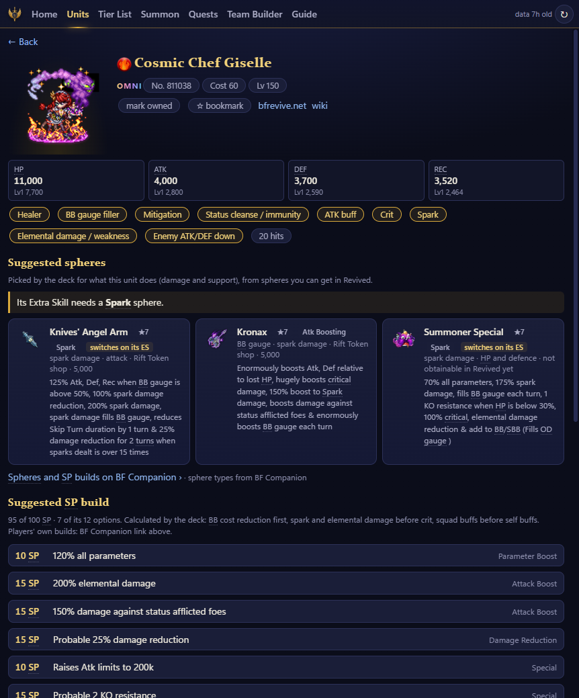
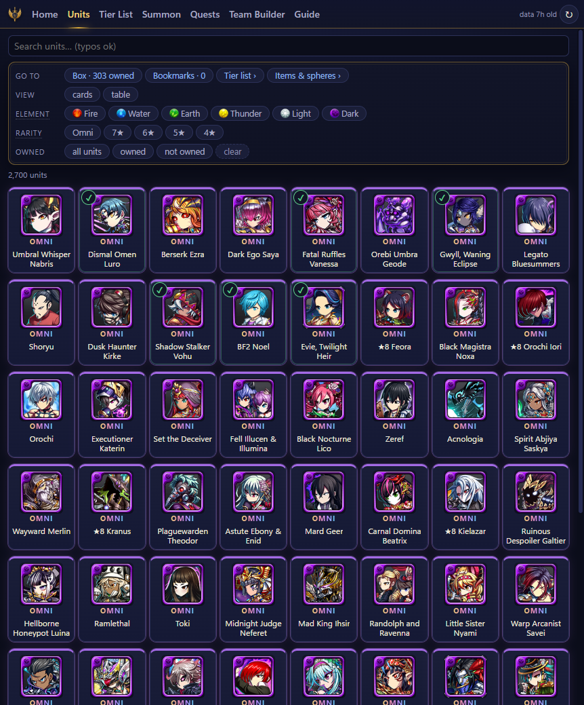
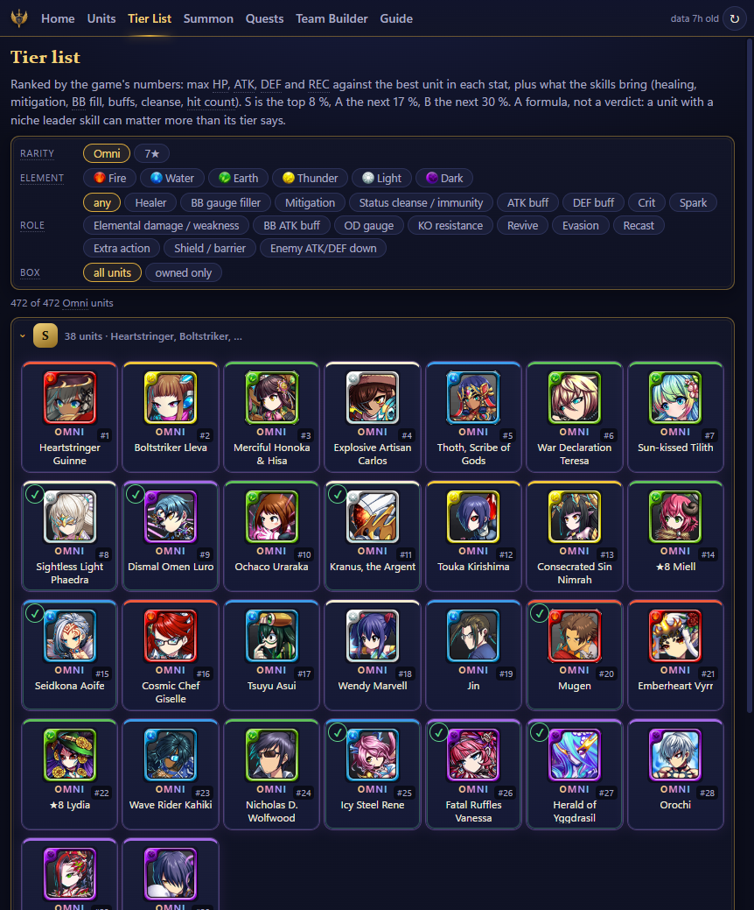
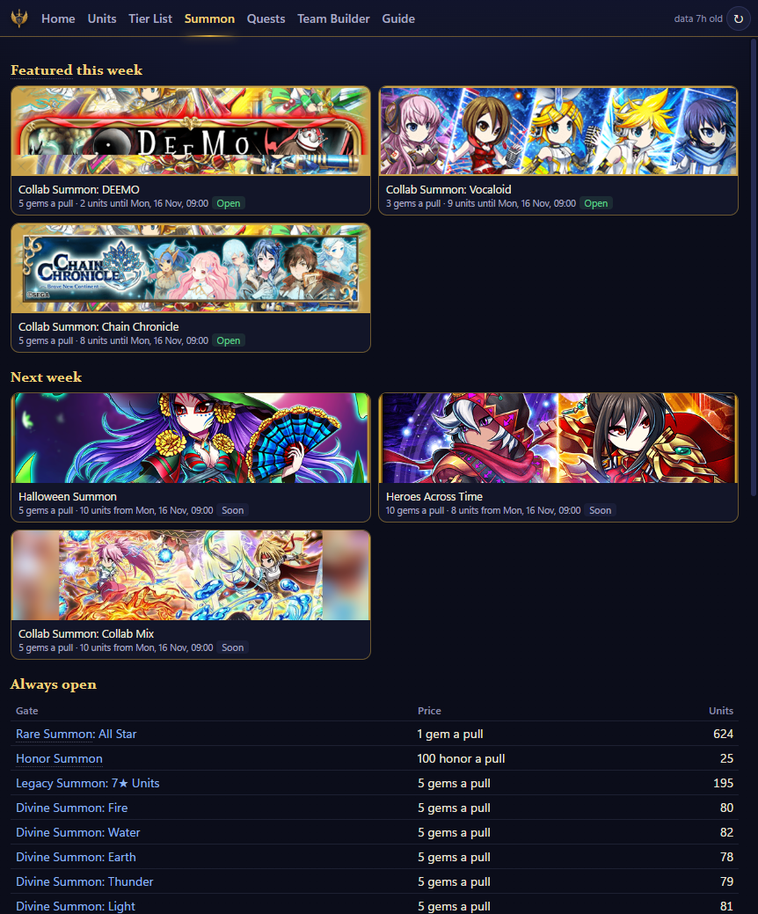
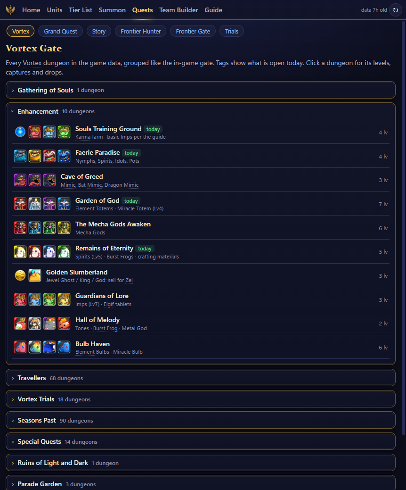
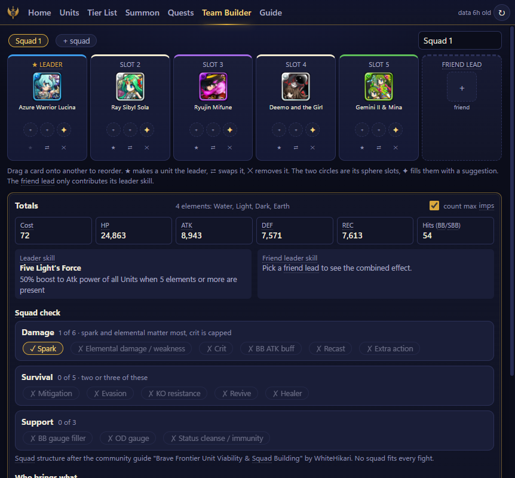
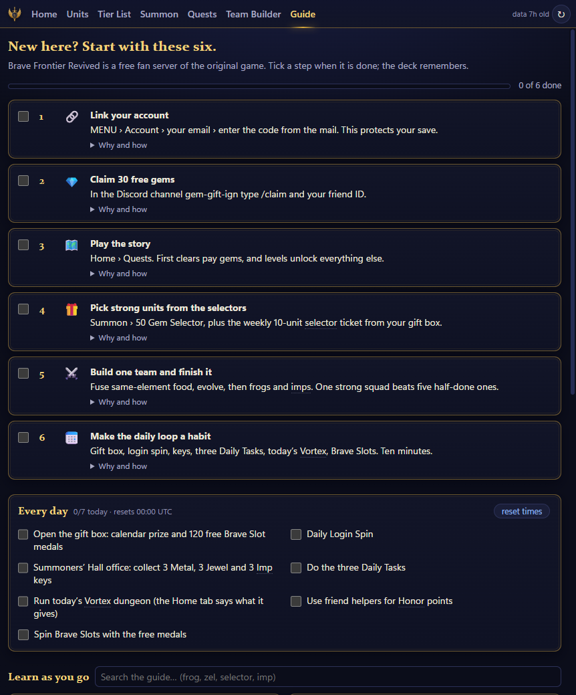
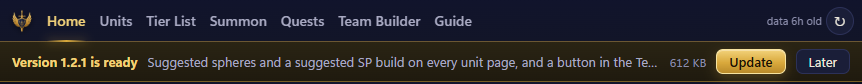

<h1 align="center">BFR Deck</h1>

<p align="center">
  <b>Ein kostenloser Desktop-Begleiter für <a href="https://bfrevive.net">Brave Frontier Revived</a>.</b><br>
  Er sitzt neben deinem Emulator und kennt deine Box, deine Squads, jedes Tor, jeden Dungeon und jede Einheit.
</p>

<p align="center">
  <a href="https://github.com/MkUltra1984/bfr-deck/releases/latest"></a>
  
  
  <a href="LICENSE"></a>
</p>

<p align="center">
  <a href="README.md">English</a> ·
  <a href="BfrDeck/CHANGELOG.md">Changelog</a> ·
  <a href="https://github.com/MkUltra1984/bfr-deck/issues">Problem melden</a>
</p>



> Die Oberfläche des Decks ist englisch; diese Seite erklärt sie auf Deutsch.

## Kurz gesagt

- **Was es ist:** ein kleines Windows-Programm mit sieben Tabs: Home, Units, Tier List, Summon, Quests, Team Builder und ein Einsteiger-Guide.
- **Für wen:** neue und zurückkehrende Spieler, die Antworten wollen, ohne zu suchen: Soll ich ziehen, was ist heute offen, wer fehlt in meinem Squad.
- **Nur lesend:** Es liest die öffentlichen Daten von bfrevive.net und, nur wenn du es einschaltest, ein Bild deines Emulatorfensters. Wenn du dich anmeldest, liest es außerdem dein eigenes Konto aus My Summoner (bfrevive.net/my-summoner). Keine Eingaben, kein Auslesen des Speichers, kein Mitlesen des Netzwerks.
- **Frei und offen:** MIT-Lizenz, der komplette Quellcode liegt in diesem Repository.

**Auf dieser Seite:** [Installation](#installation) · [Was es kann](#was-es-kann) · [Für das BFR-Team und Prüfer](#für-das-bfr-team-und-prüfer) · [Selbst bauen](#selbst-bauen) · [Dank und Lizenz](#dank-und-lizenz)

## Installation

1. `BfrDeck-win-x64.zip` aus dem [neuesten Release](https://github.com/MkUltra1984/bfr-deck/releases/latest) laden und irgendwohin entpacken.
2. `BfrDeck.exe` doppelklicken. Sonst ist nichts zu installieren.
3. Das war der letzte Download. Gibt es eine neue Version, bietet eine Leiste unter den Tabs sie an, und ein Klick installiert sie.

> [!IMPORTANT]
> Windows SmartScreen warnt einmal, weil die Datei nicht signiert ist. Auf **Weitere Informationen → Trotzdem ausführen** klicken. Wer möchte, baut das Programm selbst aus dem Quellcode unten.

## Was es kann

### Dein Konto, live



- Melde dich mit deinem Spiel-Login an, und das Deck liest dein Konto aus My Summoner (bfrevive.net/my-summoner): Level, Energie, Währungen, deine Box, deine Squads und deine Items. Nur lesend, und die Zugangsdaten gehen nur an bfrevive.net.
- **My Account:** was als Nächstes ansteht, die Prüfung jedes Squads mit einem Sphären-Plan aus deinen eigenen Sphären, ein Team-Builder, der aus deiner Box wählt, was deine Einheiten zum Entwickeln brauchen samt Einkaufsliste, Herausforderungen, Story, Sammlung und Verlauf.
- Eine Einheit, die du besitzt, zeigt, welche deiner Sphären zu ihr passen und was zu verbessern ist.
- Ohne Anmeldung funktioniert das Deck auch: Hake die Einheiten, die du besitzt, von Hand ab. Die neuen Seiten sind vorerst auf Englisch.

### Startseite (Home)

- **Reset-Timer** für Dailies, den Vortex-Tag und den Weekly Selector.
- **Dein Squad** mit den echten Kampf-Sprites, Kosten, Elementen und Leader Skill.
- **Should I pull?** gibt für jedes offene Tor ein Urteil, gemessen an den Einheiten, die du schon hast; die Chancen sind einen Klick entfernt.
- **Einheiten der Woche** und die aktuellen Banner mit ihrer Restzeit.
- Angemeldet zeigen Kopf und Kacheln dein Level, deine Gems, Zel und Karma aus deinem Konto, alle paar Minuten von selbst neu gelesen.

### Einheiten und Einheitenseiten



- Suche mit Tippfehler-Toleranz, Filter nach Element und Seltenheit, Einheiten als vorhanden oder gemerkt markieren.
- Jede Einheitenseite zeigt den animierten Sprite, Werte, Rollen, alle Skills, die Entwicklungsreihe und woher man die Einheit bekommt.
- **Sphären-Vorschläge:** zwei pro Einheit. Die Sphäre oder der Sphären-Typ, den der Extra Skill verlangt, kommt zuerst, und genannt werden nur Sphären, die es in Revived wirklich gibt, mit ihrer Quelle.
- **Vorgeschlagener SP-Build** für Omni-Einheiten, innerhalb von 100 SP.

<details>
<summary>Bild: die Einheitenliste</summary>


</details>

### Tier List



- Jede Einheit von S bis C eingestuft, nach ihren Maximalwerten und danach, was ihre Skills einem Squad bringen.
- Filter nach Element, Seltenheit, Rolle oder nur eigenen Einheiten.
- Es ist eine Formel, und die Seite sagt das auch: Eine Einheit mit einem speziellen Leader Skill kann wichtiger sein als ihre Stufe.

### Beschwörung und Quests



- **Summon:** die Tore dieser und der nächsten Woche, die dauerhaft offenen Tore und die Rotation mit Daten. Eine Torseite zeigt die Chancen pro Seltenheit und den ganzen Pool mit deinen vorhandenen Einheiten markiert.
- **Quests:** das Vortex Gate als Katalog, dazu Grand Quest, Story, Frontier Hunter, Frontier Gate und Trials, jeweils mit dem, was es gibt. Eine Dungeonseite listet Fänge mit ihrer Chance, Drops und Gegner.

<details>
<summary>Bild: der Quests-Tab</summary>


</details>

### Team Builder



- Fünf Einheiten und ein Freund als Leader, zwei Sphären pro Platz, Umsortieren durch Ziehen. Der ✦-Knopf füllt leere Sphären-Plätze mit einem Vorschlag.
- **Squad-Check:** was dein Squad für Schaden, Überleben und Unterstützung abdeckt und was fehlt.
- **Who brings what:** eine Tabelle aller Buffs und des Skills, der sie bringt.
- **Lücken füllen:** die besten Einheiten aus deiner eigenen Box für jeden fehlenden Effekt. Ein Squad lässt sich als kurzer Team-Code teilen.

### Einsteiger-Guide



- Sechs erste Schritte zum Abhaken und eine tägliche Checkliste, die um 00:00 UTC zurückgesetzt wird.
- Eine kurze Seite pro Thema: Währungen, Frösche, Entwicklung, Imps, Sphären, Farm-Tage, Beschwörungen.
- Spielbegriffe erklären sich überall im Deck selbst, wenn man mit der Maus darauf zeigt.

### Angedockt neben dem Emulator


- **Dock** heftet das Deck an die Seite des Emulators und hält beide zusammen, wenn eines bewegt wird. **Pin** hält es im Vordergrund.
- BlueStacks, LDPlayer, Nox, MEmu, MuMu, GameLoop und der Android-Studio-Emulator werden erkannt. Bei allem anderen <kbd>Shift</kbd> halten, Dock klicken, dann den Emulator anklicken.
- Dieses Bild stammt aus einer früheren Version; das Deck trägt inzwischen das Indigo-und-Gold-Design der anderen Bilder. [In Bewegung ansehen (GIF, 24 MB)](docs/img/home.gif).

### Aktualisiert sich selbst



- Das Deck prüft beim Start die Release-Seite auf GitHub. Ohne deinen Klick wird nichts installiert.
- Die meisten Updates sind kleiner als 1 MB und dauern eine Sekunde. Deine Box, Squads und Notizen bleiben unberührt.

## Für das BFR-Team und Prüfer

**Was das Deck liest**

| Quelle | Was | Wie oft |
|---|---|---|
| `bfrevive.net/data/units.json`, `items.json`, `summons.json`, `events.json` und `/units/meta.json` | die öffentlichen Daten-Feeds | 3 Stunden auf der Festplatte zwischengespeichert |
| `bfrevive.net/units/u/<id>.json` | die Skills einer Einheit, wenn ihre Seite geöffnet wird oder eine Liste sie braucht | auf der Festplatte zwischengespeichert |
| `cdn.bfrevive.net` | Icons, Sprites, Item- und Torbilder | 14 Tage zwischengespeichert, höchstens 300 MB |
| die Tabs „BFRevived“ und „Wiki“ | bfrevive.net und das Brave-Frontier-Wiki, in einem eingebetteten Browser angezeigt wie in jedem Browser | nur wenn du sie öffnest |
| `github.com/MkUltra1984/bfr-deck` | die Update-Prüfung | beim Start und alle 6 Stunden |

Anfragen des Decks geben sich als `BfrDeck/0.1 (+companion app; read-only)` zu erkennen. Ist die Seite nicht erreichbar, zeigt das Deck seine letzte gute Kopie.

**Was das Deck nie tut**

- Es sendet keine Eingaben an das Spiel: keine Klicks, keine Makros, keine Automatisierung.
- Es liest und schreibt weder den Speicher noch die Dateien des Spiels und fasst weder den Emulator noch die APK an.
- Es liest, verändert oder wiederholt keinen Netzwerkverkehr.
- Es kennt kein Konto, solange du dich nicht selbst anmeldest. Dann gehen deine Zugangsdaten nur an bfrevive.net, das Deck liest dein Konto nur und ändert nie etwas daran, und „angemeldet bleiben“ legt die Zugangsdaten von Windows geschützt für deinen Benutzer auf deinem PC ab. Abmelden entfernt sie.
- Es sammelt nichts: keine Telemetrie, keine Statistik, kein eigener Server. Deine Box und deine Squads bleiben auf deinem PC.

**Falls etwas geändert werden soll:** Wenn das Deck eure Server zu oft anfragt, Daten zeigt, die ihr lieber nicht gezeigt hättet, oder etwas falsch formuliert, [öffnet ein Issue](https://github.com/MkUltra1984/bfr-deck/issues) oder sagt es mir im BFR-Discord, und ich ändere es.

**Nutzt es, wie ihr wollt:** Das BFR-Team darf alles in diesem Repository ganz oder teilweise übernehmen, verändern oder darauf aufbauen, ohne zu fragen. Die MIT-Lizenz erlaubt das ohnehin; hier steht es nur noch einmal in klaren Worten.

**Wie es entstanden ist:** Der Code wurde von einem KI-Programmierassistenten (Claude von Anthropic) unter meiner Leitung geschrieben. Die Ideen, die Entscheidungen über Funktionen und Design und die Tests im Spiel stammen von mir; ich lese Code und finde mich darin zurecht, bin aber kein professioneller Entwickler. Der gesamte Quellcode ist offen, damit jeder prüfen kann, was das Programm tut.

## Selbst bauen

<details>
<summary>Schritte und Kommandozeilen-Schalter</summary>

Nötig sind Windows 10 oder 11 und das [.NET 9 SDK](https://dotnet.microsoft.com/download/dotnet/9.0).

```powershell
cd BfrDeck
dotnet build -c Release
bin\Release\net9.0-windows10.0.19041.0\win-x64\BfrDeck.exe
```

Die Oberfläche ist reines HTML und JavaScript in `BfrDeck/wwwroot` ohne Build-Schritt: ändern, neu laden. `rules.js` enthält die serverspezifischen Zahlen. `tools\publish.ps1` erzeugt die einzelne exe, `tools\release.ps1` die Release-Dateien. Aufbau des Codes: [BfrDeck/README.md](BfrDeck/README.md).

| Schalter | Wirkung |
|---|---|
| `--dock` | beim Start neben dem Emulator andocken |
| `--deck "#/home/99017"` | eine Route öffnen; `#/home/<gate>` wählt das Tor für Should I pull vor |
| `--ocrtest frame.png` | den Live-Werte-Leser auf ein gespeichertes Bild (1080×1920) anwenden und beenden |

Protokolle, Zwischenspeicher und Einstellungen liegen in `%LOCALAPPDATA%\BfrDeck`.
</details>

## Dank und Lizenz

> [!WARNING]
> Makros, veränderte Clients, veränderte Emulatoren und Cheat-Tools sind auf BF Revived verboten. BFR Deck bleibt auf der richtigen Seite dieser Linie. Bitte auch in Forks so halten.

- **Lizenz:** MIT, siehe [LICENSE](LICENSE).
- **Das Spiel:** Brave Frontier und alle Spielgrafiken, Einheitennamen und Daten gehören ihren Eigentümern (gumi / Alim). Brave Frontier Revived ist ein Fanprojekt auf bfrevive.net. Dieser Begleiter steht mit keinem von ihnen in Verbindung.
- **Danke an das BFR-Team** dafür, dass es das Spiel zurückgebracht hat und seine Daten veröffentlicht.
- **Danke an [BF Companion](https://bfcompanion.app/)** (Nervequakes): Die Sphären-Typen hinter den Sphären-Vorschlägen stammen aus dessen Daten, und jede Einheitenseite verlinkt dort auf die Einheit.
- **Danke an WhiteHikari:** Der Squad-Check folgt dem Aufbau des Community-Guides „Brave Frontier Unit Viability & Squad Building“.
