<p align="center">
  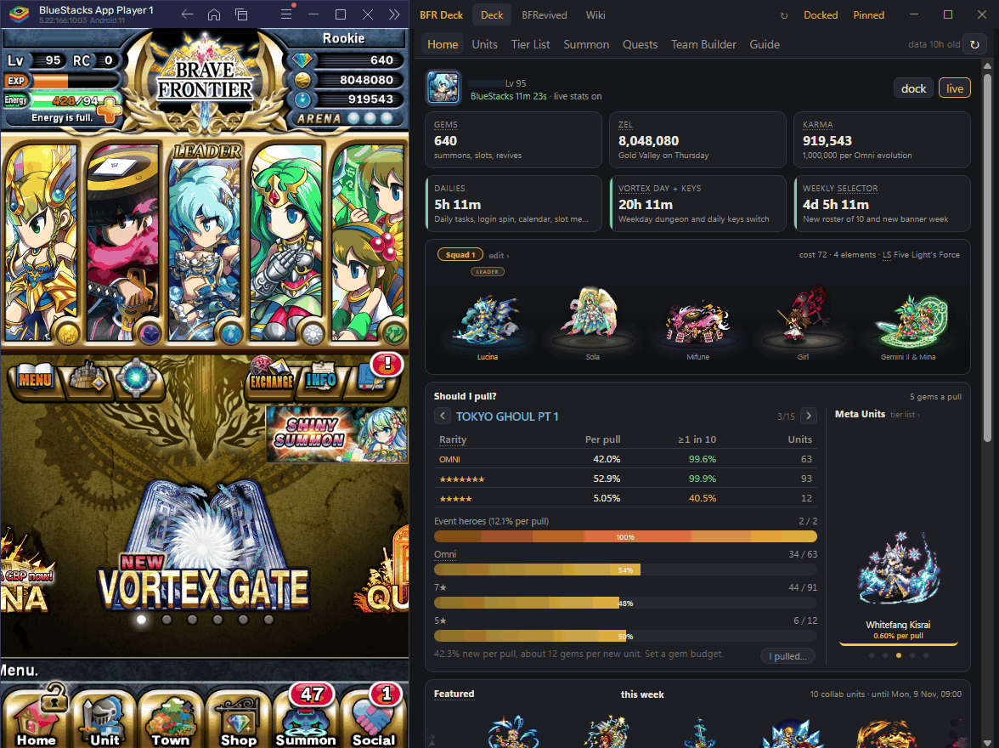
</p>

<h1 align="center">BFR Deck</h1>

<p align="center">
  <b>Der Desktop-Begleiter für <a href="https://bfrevive.net">Brave Frontier Revived</a>.</b><br>
  Dockt neben deinen Emulator. Kennt deine Box, deine Squads, jedes Gate, jeden Dungeon und jede Einheit.
</p>

<p align="center">
  <a href="https://github.com/MkUltra1984/bfr-deck/releases/latest"></a>
  
  
  <a href="LICENSE"></a>
</p>

<p align="center">
  <a href="README.md">🇬🇧 English guide</a> &nbsp;·&nbsp; <a href="BfrDeck/CHANGELOG.md">📋 Changelog (englisch)</a> &nbsp;·&nbsp; <a href="https://github.com/MkUltra1984/bfr-deck/issues">🐛 Problem melden</a>
</p>

---

## ⬇️ Installation

**1.** `BfrDeck-win-x64.zip` aus dem [neuesten Release](https://github.com/MkUltra1984/bfr-deck/releases/latest) laden und irgendwohin entpacken.
**2.** `BfrDeck.exe` doppelklicken. Sonst nichts zu installieren.

> [!IMPORTANT]
> Windows SmartScreen warnt einmal, weil die Datei nicht signiert ist. Auf **Weitere Informationen → Trotzdem ausführen** klicken. Der komplette Quellcode liegt in diesem Repository; wer möchte, baut die Datei selbst.

> [!NOTE]
> **Nur lesend, von Grund auf.** Das Deck liest die öffentlichen Daten von bfrevive.net und, nur wenn du es einschaltest, ein Bild deines Emulatorfensters. Es sendet nie Eingaben, liest nie Speicher, fasst nie den Netzwerkverkehr an. Nichts, was die Serverregeln verbieten.

## 🏠 Startseite

<table>
<tr>
<td width="50%" valign="top">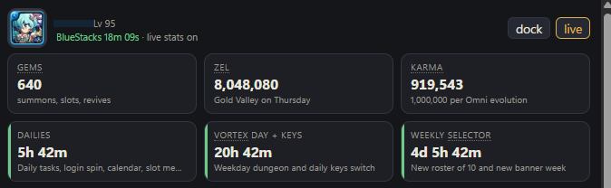<br>🔴 <b>Live-Kopfzeile</b> · dein Name, <b>Gems, Zel und Karma</b> vom Spielbildschirm abgelesen. <b>Reset-Timer</b> für Dailies, den Vortex-Tag und den wöchentlichen Selector.</td>
<td width="50%" valign="top">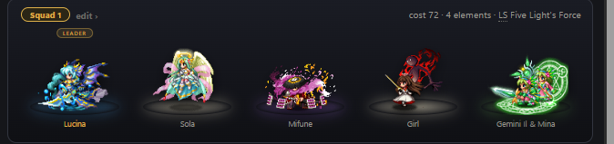<br>⚔️ <b>Dein Squad</b> · die echten <b>Kampf-Sprites</b> auf elementfarbenen Plattformen, mit Kosten, Elementen und Leader Skill. Wird vom Einheiten-Scan gefüllt.</td>
</tr>
<tr>
<td valign="top">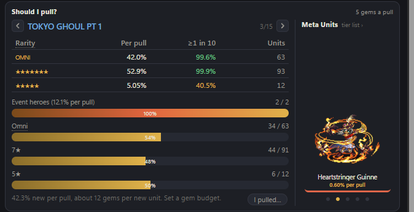<br>🎲 <b>Soll ich ziehen?</b> · Chancen pro Seltenheit, wie viel des Gates du <b>schon besitzt</b>, Gems pro neuer Einheit, die <b>Meta-Einheiten</b> des Gates. <b>I pulled…</b> trägt eine Beschwörungsrunde in einem Rutsch nach.</td>
<td valign="top">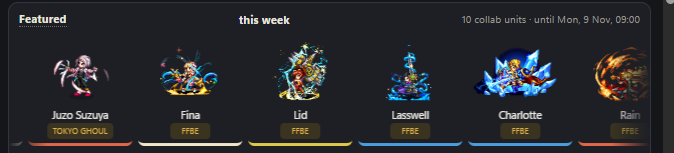<br>✨ <b>Diese Woche im Fokus</b> · die Collab- und Rate-up-Einheiten laufen vorbei; ziehen zum Blättern.<br><br>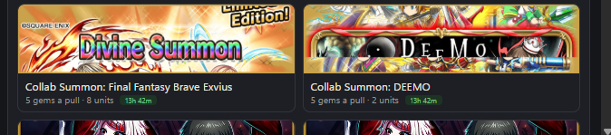<br>🎫 <b>Banner</b> · die Gates der Woche mit Preis und Restzeit, darunter die nächste Woche.</td>
</tr>
<tr>
<td colspan="2" valign="top">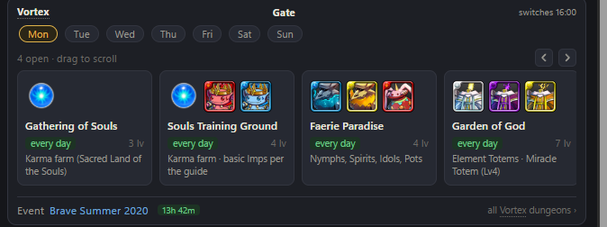<br>🌀 <b>Vortex-Tor</b> · die Woche als Tages-Chips, eine Karte pro offenem Dungeon mit dem, <b>was er bringt, in klaren Worten</b>, und seinen Fängen oder Drops als Bilder. Eine Karte öffnet die Dungeon-Seite.</td>
</tr>
</table>

## 🧩 Einheiten

<table>
<tr>
<td width="50%" valign="top">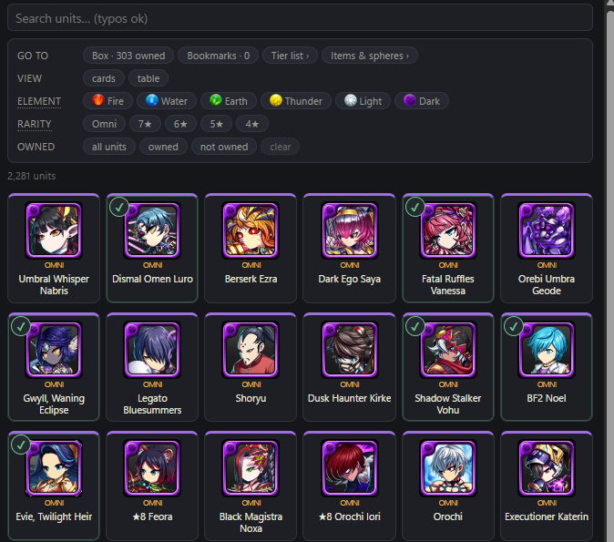<br>🔍 <b>Einheiten</b> · Suche mit Tippfehler-Toleranz, Element- und Seltenheitsfilter, Karten oder Tabelle. <b>✔ besessen</b>, <b>★ gemerkt</b>.</td>
<td width="50%" valign="top">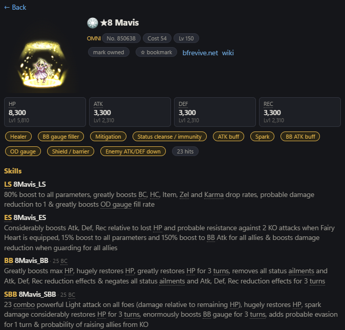<br>📄 <b>Einheitenseite</b> · animierter Sprite, Werte, Rollen, alle Skills, und <b>wo man sie bekommt</b>: Gates mit Raten, Quests mit Fangchance.</td>
</tr>
<tr>
<td valign="top">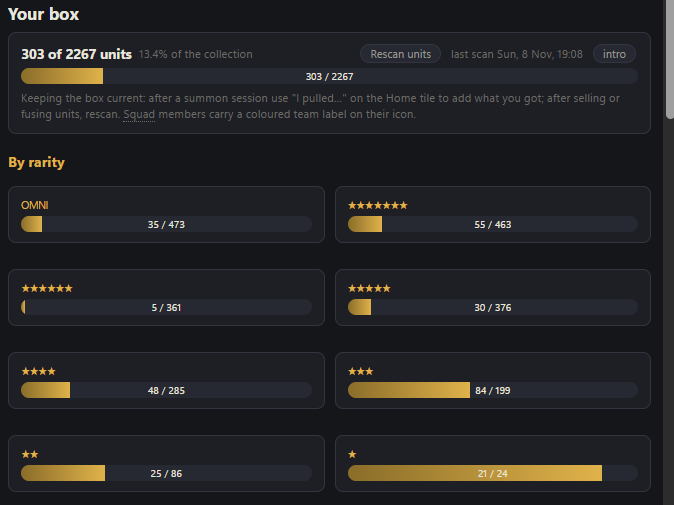<br>📦 <b>Box</b> · deine Sammlung mit Fortschritt pro Seltenheit und Element. Nach Verkaufen oder Fusionieren neu scannen.</td>
<td valign="top">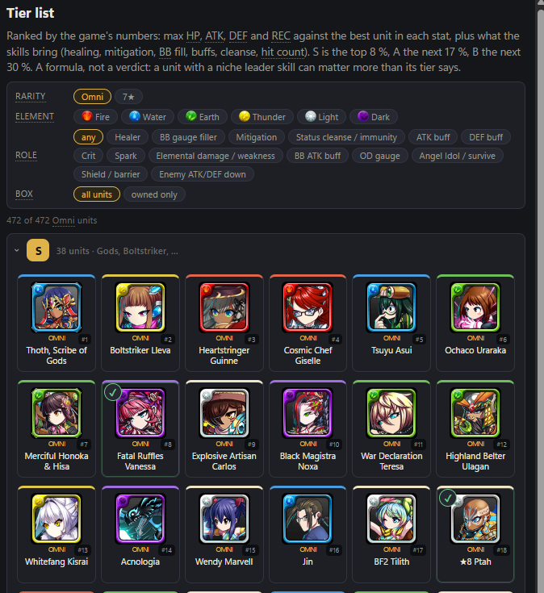<br>🏆 <b>Tier List</b> · jede Einheit von <b>S bis C</b> nach Maximalwerten und den Rollen ihrer Skills. Filter nach Element, Seltenheit, Rolle oder nur besessene.</td>
</tr>
</table>

## 🎰 Beschwörung und Quests

<table>
<tr>
<td width="50%" valign="top">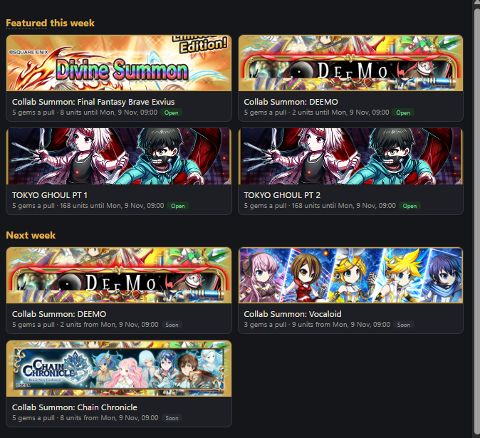<br>🎰 <b>Beschwörung</b> · diese Woche, nächste Woche, die immer offenen Gates und die Rotation mit Terminen.</td>
<td width="50%" valign="top">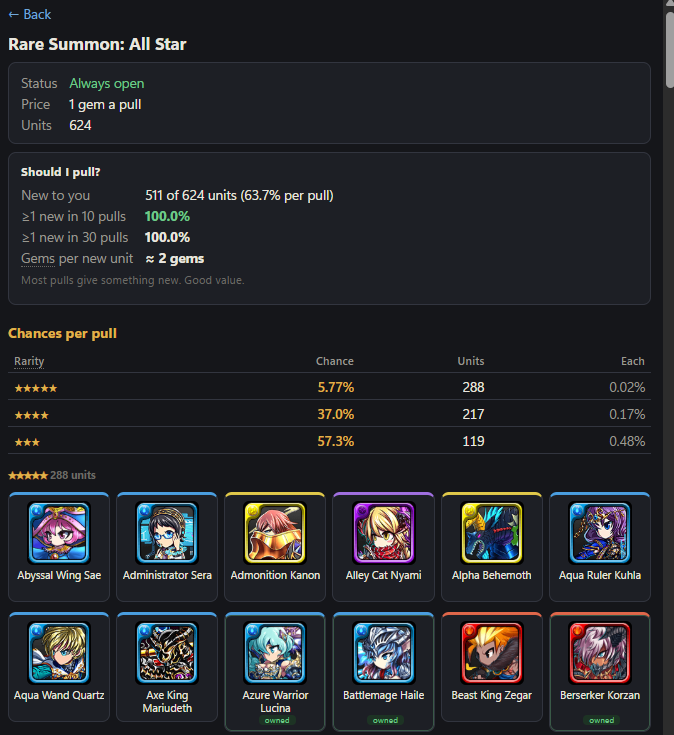<br>💎 <b>Gate-Seite</b> · das <b>Urteil gegen deine Box</b>, Chancen pro Seltenheit, der ganze Pool mit Besitz-Markierung.</td>
</tr>
<tr>
<td valign="top">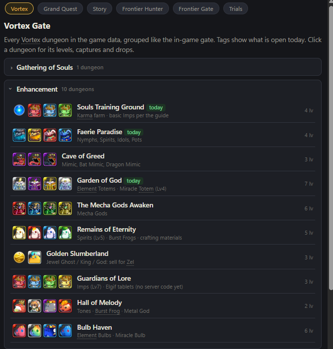<br>🗺️ <b>Quests</b> · das ganze Vortex-Tor als Katalog, dazu Grand Quest, Story, Frontier Hunter, Frontier Gate und Trials, jeweils mit dem, <b>was er bringt</b>.</td>
<td valign="top">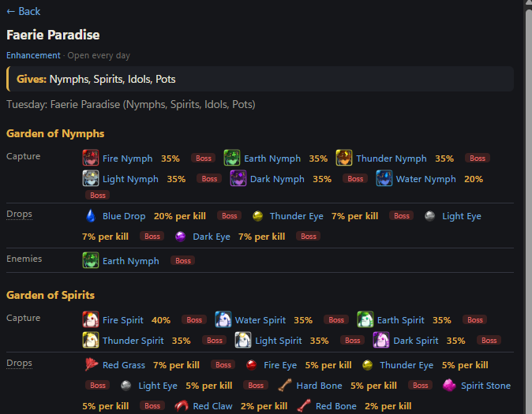<br>🏰 <b>Dungeon-Seite</b> · was er bringt, dann jede Stufe mit <b>Fängen und Chance</b>, Drops pro Kill, Gegner.</td>
</tr>
</table>

## 🛡️ Team Builder

<table>
<tr>
<td colspan="2" valign="top">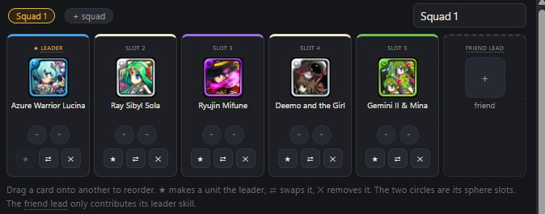<br>🃏 <b>Sechs Plätze</b> · fünf Einheiten und der Freund-Leader. <b>★</b> Leader, <b>⇄</b> tauschen, <b>✕</b> entfernen, ziehen zum Umsortieren, zwei Sphären pro Platz.</td>
</tr>
<tr>
<td width="50%" valign="top">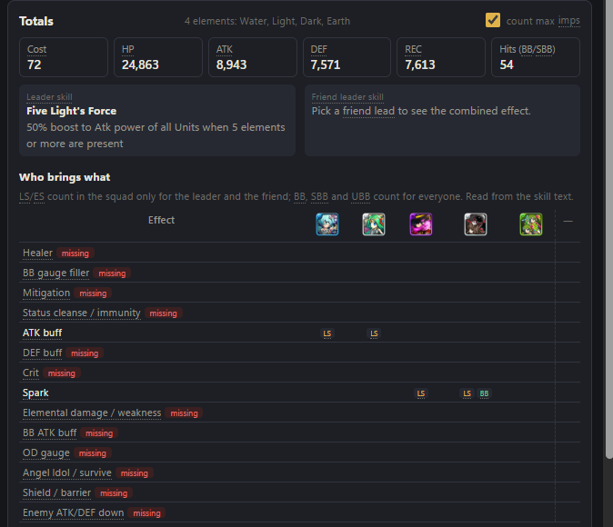<br>📊 <b>Wer bringt was</b> · Summen, beide Leader Skills und eine Matrix aus Heilung, Schadensminderung, BB-Füllung und Buffs pro Platz. <b>Fehlendes ist markiert.</b></td>
<td width="50%" valign="top">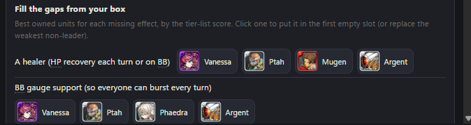<br>🧠 <b>Lücken füllen</b> · die besten Einheiten <b>aus deiner Box</b> für jede fehlende Wirkung; ein Klick setzt sie ein. Squads teilen per <b>Team-Code</b>.</td>
</tr>
</table>

## 📖 Einsteiger-Guide

<table>
<tr>
<td width="50%" valign="top">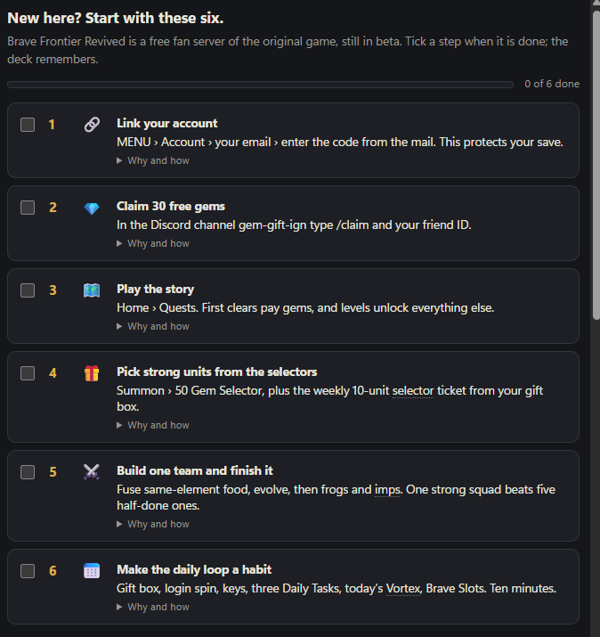<br>✅ <b>Sechs erste Schritte</b> · Account verknüpfen, Gems abholen, Story, Selectors, ein fertiges Team, die tägliche Runde. Abhaken; das Deck merkt es sich. Eine <b>Jeden-Tag</b>-Liste setzt sich um 00:00 UTC zurück.</td>
<td width="50%" valign="top">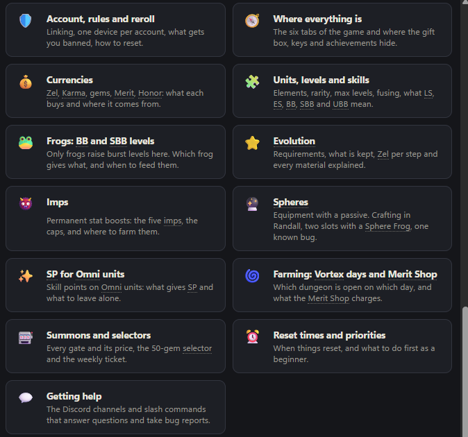<br>🗂️ <b>Eine Karte pro Thema</b> · Währungen, Frösche, Entwicklung, Imps, Sphären, Farm-Tage, Beschwörungen, Hilfe. Jede öffnet ihre eigene kurze Seite. <b>Jeder Spielbegriff</b> im Deck erklärt sich beim Überfahren mit der Maus. Guide-Texte derzeit auf Englisch.</td>
</tr>
</table>

## 🚀 Erster Start

<table>
<tr>
<td width="50%" valign="top">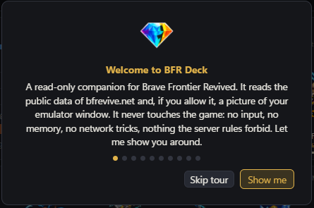<br>👋 <b>Begrüßung und Tour</b> · eine Karte pro Tab und Bereich, über dem echten Bildschirm gezeigt. Wiederholbar von der Box-Seite.</td>
<td width="50%" valign="top">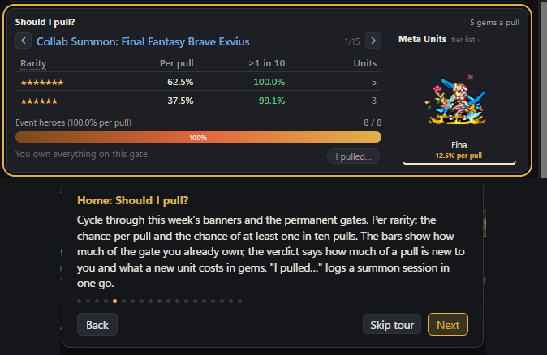<br>🎯 <b>Tour-Karte</b> · der beschriebene Bereich wird ins Bild gescrollt und <b>golden umrandet</b>.</td>
</tr>
<tr>
<td valign="top">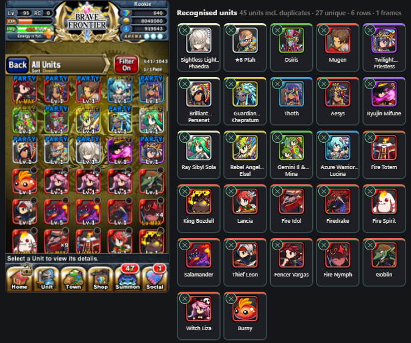<br>📷 <b>Einheiten-Scanner</b> · Einheitenliste im Spiel öffnen und scrollen. Das Deck beobachtet das Emulatorfenster, legt ein Raster auf die Zeilen, <b>erkennt jedes Symbol</b> und liest die ×N-Stapel. Das gelbe PARTY-Band wird zu Squad 1. <b>Keine Kalibrierung, jeder Emulator.</b></td>
<td valign="top">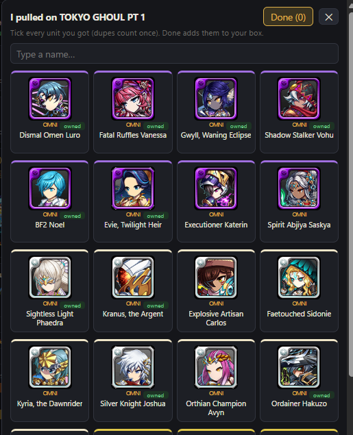<br>➕ <b>I pulled…</b> · nach einer Beschwörungsrunde abhaken, was du aus dem Pool des Gates bekommen hast. <b>Done</b> fügt es deiner Box hinzu.</td>
</tr>
</table>

## 🪟 Angedockt

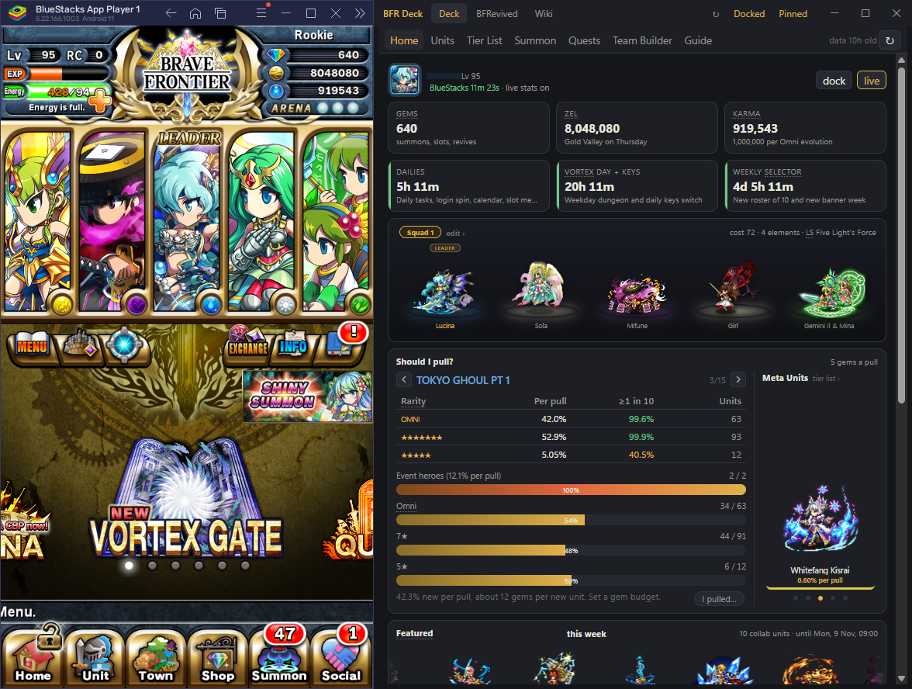

**Dock** schmiegt das Deck an die Seite des Emulators und hält beide zusammen, wenn eines bewegt wird. **BlueStacks, LDPlayer, Nox, MEmu, MuMu, GameLoop** und der Android-Studio-Emulator werden erkannt; für alles andere <kbd>Shift</kbd> halten, Dock klicken, Emulator anklicken. **Pin** hält das Deck im Vordergrund.

## ⌨️ Kommandozeile

| Schalter | Wirkung |
|---|---|
| `--dock` | beim Start neben den Emulator docken |
| `--deck "#/home/99017"` | eine Route öffnen; `#/home/<gate>` wählt das „Soll ich ziehen“-Gate vor |
| `--ocrtest frame.png` | den Live-Statistik-Leser auf ein gespeichertes 1080×1920-Bild anwenden und beenden |

Logs, Cache und Einstellungen liegen in `%LOCALAPPDATA%\BfrDeck`.

## 🔧 Selbst bauen

Windows 10/11 und das [.NET 9 SDK](https://dotnet.microsoft.com/download/dotnet/9.0).

```powershell
cd BfrDeck
dotnet build -c Release
bin\Release\net9.0-windows10.0.19041.0\win-x64\BfrDeck.exe
```

Die Oberfläche ist reines HTML und JavaScript in `BfrDeck/wwwroot` ohne Build-Schritt: ändern, neu laden. `rules.js` enthält die serverspezifischen Zahlen. `tools\publish.ps1` erzeugt die einzelne Exe. Code-Aufbau: [BfrDeck/README.md](BfrDeck/README.md) (englisch).

## ⚖️ Serverregeln und Lizenz

> [!WARNING]
> Makros, veränderte Clients, veränderte Emulatoren und Cheat-Tools sind auf BF Revived **verboten**. BFR Deck bleibt auf der richtigen Seite dieser Linie: öffentliche Daten, ein Bild des Bildschirms, keine Eingaben, kein Speicher, kein Netzwerkverkehr. Bitte auch in Forks so halten.

**MIT**, siehe [LICENSE](LICENSE). Brave Frontier und alle Spielgrafiken, Einheitennamen und Daten gehören ihren jeweiligen Eigentümern (gumi / Alim); Brave Frontier Revived ist ein Fanprojekt auf bfrevive.net. Dieser Begleiter steht mit keinem von ihnen in Verbindung.
