<h1 align="center">BFR Deck</h1>

<p align="center">
  <b>A free desktop companion for <a href="https://bfrevive.net">Brave Frontier Revived</a>.</b><br>
  It sits beside your emulator and knows your box, your squads, every gate, dungeon and unit.
</p>

<p align="center">
  <a href="https://github.com/MkUltra1984/bfr-deck/releases/latest"></a>
  
  
  <a href="LICENSE"></a>
</p>

<p align="center">
  <a href="README.de.md">Deutsch</a> ·
  <a href="BfrDeck/CHANGELOG.md">Changelog</a> ·
  <a href="https://github.com/MkUltra1984/bfr-deck/issues">Report a problem</a>
</p>

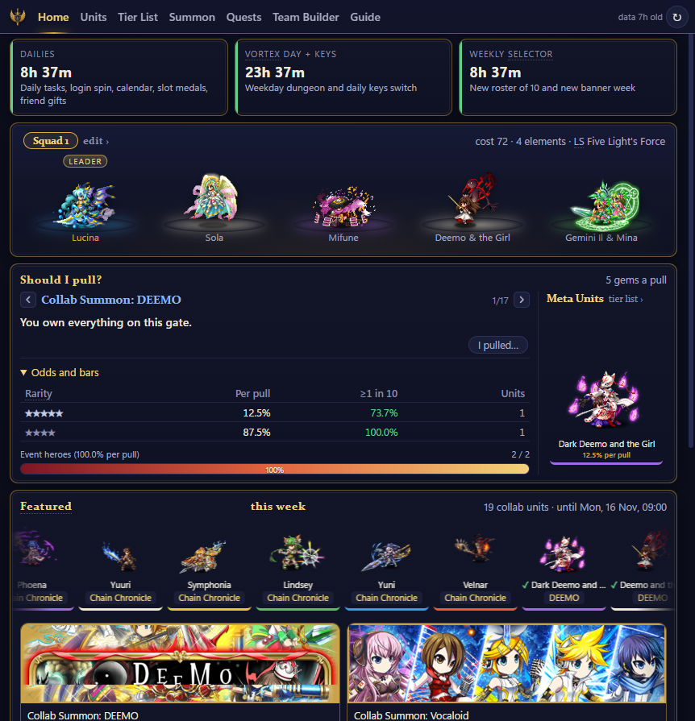

## In short

- **What it is:** a small Windows program with seven tabs: Home, Units, Tier List, Summon, Quests, Team Builder and a beginner Guide.
- **Who it is for:** new and returning players who want answers without digging: should I pull, what is open today, who is missing in my squad.
- **Read-only:** it reads the public data of bfrevive.net and, only if you switch it on, a picture of your emulator window. If you sign in, it also reads your own account from My Summoner (bfrevive.net/my-summoner). No input, no memory reading, no network sniffing.
- **Free and open:** MIT license, the complete source is in this repository.

**On this page:** [Install](#install) · [What it does](#what-it-does) · [For the BFR team and reviewers](#for-the-bfr-team-and-reviewers) · [Build from source](#build-from-source) · [Credits and license](#credits-and-license)

## Install

1. Download `BfrDeck-win-x64.zip` from the [latest release](https://github.com/MkUltra1984/bfr-deck/releases/latest) and unzip it anywhere.
2. Double-click `BfrDeck.exe`. There is nothing else to install.
3. That was the last download. When a new version is out, a bar under the tabs offers it and one click installs it.

> [!IMPORTANT]
> Windows SmartScreen warns once because the file is not code-signed. Click **More info → Run anyway**. If you prefer, build it yourself from the source below.

## What it does

### Home

- **Reset timers** for dailies, the Vortex day and the weekly selector.
- **Your squad** with the real battle sprites, cost, elements and leader skill.
- **Should I pull?** gives a verdict for each open gate against the units you already own, with the odds one click away.
- **Featured this week** and the current banners with their time left.
- With live stats on, the header shows your gems, Zel and Karma, read from a picture of the game screen.

### Units and unit pages

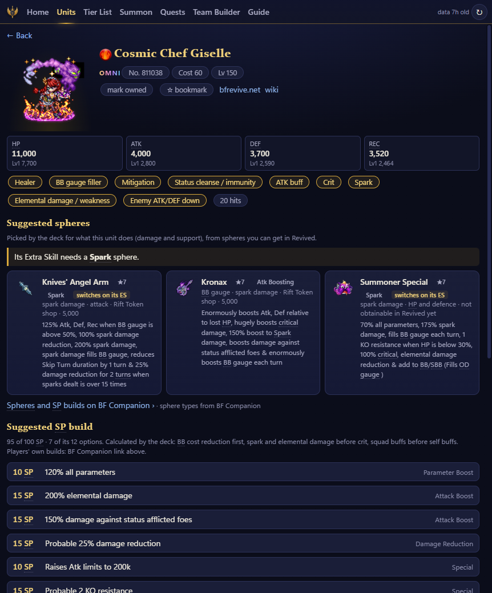

- Search with typo tolerance, filter by element and rarity, mark units as owned or bookmarked.
- Each unit page shows the animated sprite, stats, roles, every skill, the evolution line and where to get the unit.
- **Suggested spheres:** two per unit. The sphere or sphere type its Extra Skill asks for comes first, and only spheres you can really get in Revived are named, with their source.
- **Suggested SP build** for Omni units, within 100 SP.

<details>
<summary>Picture: the unit list</summary>

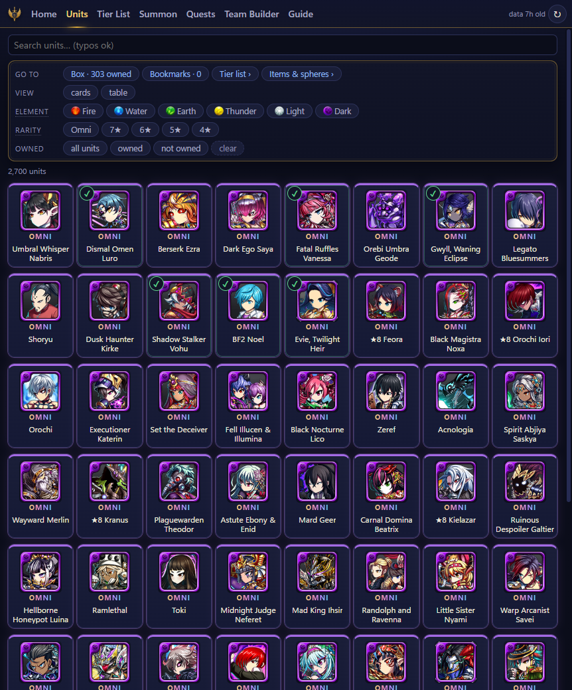
</details>

### Tier List

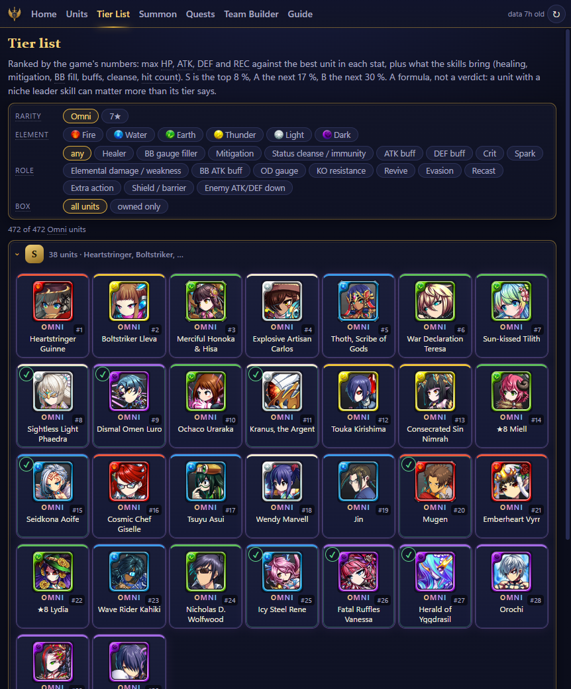

- Every unit ranked S to C by its maximum stats and by what its skills bring to a squad.
- Filter by element, rarity, role, or only the units you own.
- It is a formula, and the page says so: a unit with a niche leader skill can matter more than its tier.

### Summon and Quests

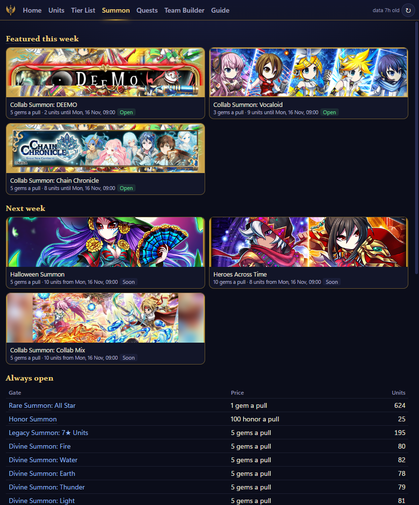

- **Summon:** this week's gates, next week's, the always-open gates and the rotation with dates. A gate page shows the chances per rarity and the full pool with your owned units marked.
- **Quests:** the Vortex Gate as a catalog, plus Grand Quest, Story, Frontier Hunter, Frontier Gate and Trials, each with what it gives. A dungeon page lists captures with their chance, drops and enemies.

<details>
<summary>Picture: the Quests tab</summary>

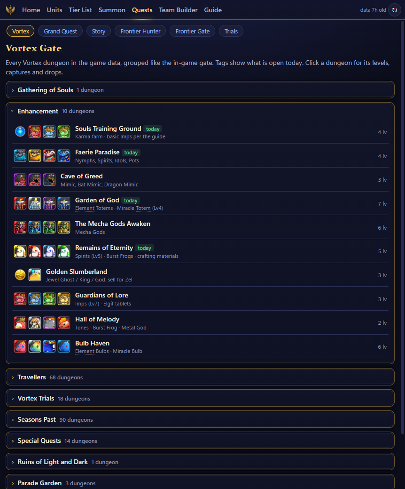
</details>

### Team Builder

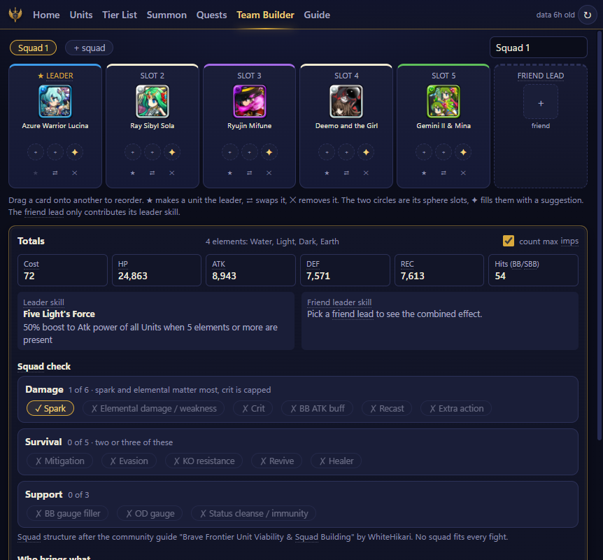

- Five units and a friend lead, two spheres per slot, drag to reorder. The ✦ button fills empty sphere slots with a suggestion.
- **Squad check:** what your squad covers for damage, survival and support, and what is missing.
- **Who brings what:** a table of every buff and the skill that brings it.
- **Fill the gaps:** the best units from your own box for each missing effect. Share a squad as a short team code.

### Beginner guide

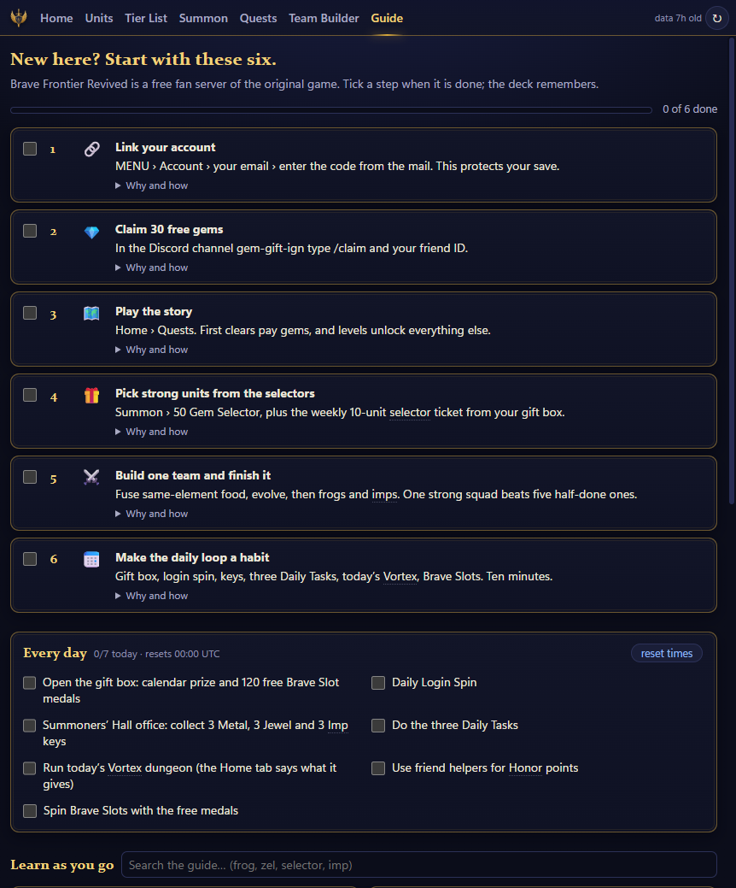

- Six first steps with checkboxes, and a daily checklist that resets at 00:00 UTC.
- One short page per topic: currencies, frogs, evolution, imps, spheres, farming days, summons.
- Game terms anywhere in the deck explain themselves when you hover over them.

### Unit scanner

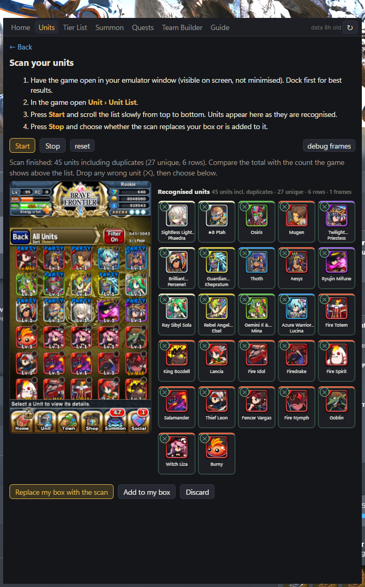

- Open the unit list in the game and scroll. The deck watches a picture of the emulator window, matches every icon and reads the ×N stacks.
- No calibration, and it works with any emulator. Your main party becomes Squad 1.
- No captured frame stays on disk.

### Docked beside the emulator

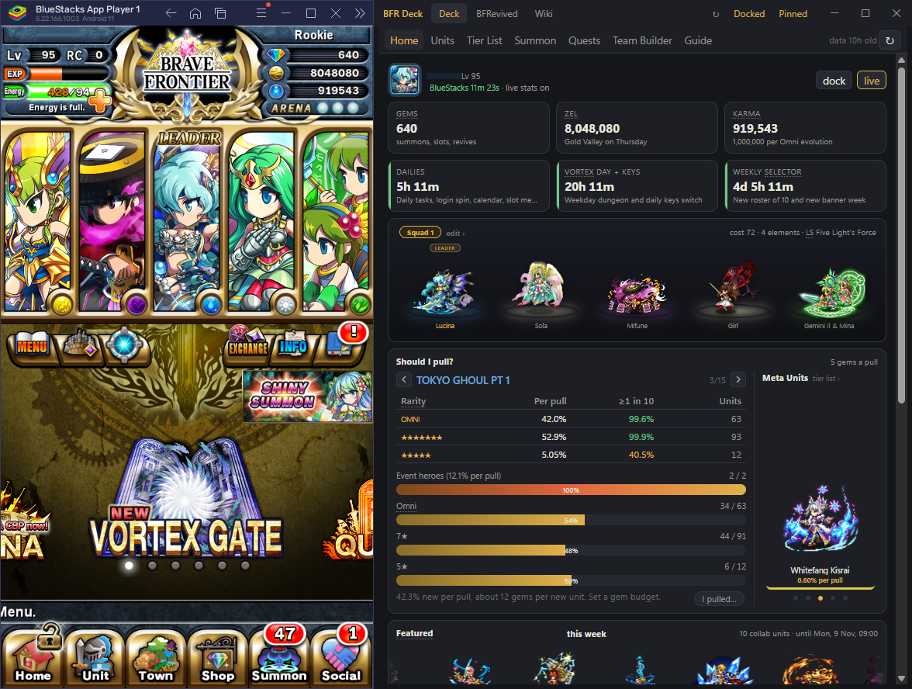

- **Dock** snaps the deck to the emulator's side and keeps the two together when either moves. **Pin** keeps it on top.
- BlueStacks, LDPlayer, Nox, MEmu, MuMu, GameLoop and the Android Studio emulator are recognised. For anything else hold <kbd>Shift</kbd>, click Dock, then click the emulator.
- This picture is from an earlier version; the deck now has the indigo and gold look of the other pictures. [See it in motion (GIF, 24 MB)](docs/img/home.gif).

### Updates itself

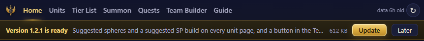

- The deck checks the GitHub releases page when it starts. Nothing installs without your click.
- Most updates are under 1 MB and take a second. Your box, squads and notes are never touched.

## For the BFR team and reviewers

**What the deck reads**

| Source | What | How often |
|---|---|---|
| `bfrevive.net/data/units.json`, `items.json`, `summons.json`, `events.json` and `/units/meta.json` | the public data feeds | cached on disk for 3 hours |
| `bfrevive.net/units/u/<id>.json` | one unit's skills, when its page is opened or a list needs it | cached on disk |
| `cdn.bfrevive.net` | unit icons, sprites, item and gate pictures | cached for 14 days, 300 MB at most |
| the "BFRevived" and "Wiki" tabs | bfrevive.net and the Brave Frontier wiki, shown in an embedded browser like any browser would | only when you open them |
| the emulator window (optional) | a picture of the screen for live stats and the unit scanner, read with Windows' own text recognition | only while switched on |
| `github.com/MkUltra1984/bfr-deck` | the update check | at start and every 6 hours |

Requests from the deck identify themselves as `BfrDeck/0.1 (+companion app; read-only)`. When the site cannot be reached, the deck shows its last good copy.

**What the deck never does**

- It sends no input to the game: no clicks, no macros, no automation.
- It does not read or write the game's memory or files, and it does not touch the emulator or the APK.
- It does not read, change or replay network traffic.
- It knows no account unless you sign in yourself. Then your login goes only to bfrevive.net, the deck only reads your account and never changes it, and "stay signed in" keeps the login protected by Windows for your user on your PC. Signing out removes it.
- It collects nothing: no telemetry, no analytics, no server of its own. Your box and squads stay on your PC.

**If something should change:** if the deck asks your servers too often, shows data you would rather not have shown, or words something wrongly, [open an issue](https://github.com/MkUltra1984/bfr-deck/issues) or tell me on the BFR Discord and I will change it.

**Use it as you like:** the BFR team may take, change or build on anything in this repository, in whole or in part, without asking. The MIT license already allows it; this is the same thing said plainly.

**How it was made:** the code was written by an AI coding assistant (Claude, by Anthropic) under my direction. The ideas, the feature decisions, the design choices and the testing in the game are mine; I read code and know my way around it, but I am not a professional developer. The whole source is open so anyone can check what it does.

## Build from source

<details>
<summary>Steps and command line switches</summary>

You need Windows 10 or 11 and the [.NET 9 SDK](https://dotnet.microsoft.com/download/dotnet/9.0).

```powershell
cd BfrDeck
dotnet build -c Release
bin\Release\net9.0-windows10.0.19041.0\win-x64\BfrDeck.exe
```

The UI is plain HTML and JavaScript in `BfrDeck/wwwroot` with no build step: edit, press reload. `rules.js` holds the server-specific numbers. `tools\publish.ps1` produces the single exe, `tools\release.ps1` the release files. Code layout: [BfrDeck/README.md](BfrDeck/README.md).

| Switch | Effect |
|---|---|
| `--dock` | dock beside the emulator on start |
| `--deck "#/home/99017"` | open a route; `#/home/<gate>` preselects the Should-I-pull gate |
| `--ocrtest frame.png` | run the live-stats reader on a saved 1080×1920 frame and exit |

Logs, cache and settings live in `%LOCALAPPDATA%\BfrDeck`.
</details>

## Credits and license

> [!WARNING]
> Macros, modified clients, modified emulators and cheat tools are banned on BF Revived. BFR Deck stays on the right side of that line. Please keep it that way in forks.

- **License:** MIT, see [LICENSE](LICENSE).
- **The game:** Brave Frontier and all game artwork, unit names and data belong to their owners (gumi / Alim). Brave Frontier Revived is a fan project at bfrevive.net. This companion is not affiliated with any of them.
- **Thanks to the BFR team** for bringing the game back and publishing its data.
- **Thanks to [BF Companion](https://bfcompanion.app/)** (Nervequakes): the sphere types behind the sphere suggestions come from its data, and every unit page links to that unit there.
- **Thanks to WhiteHikari:** the squad check follows the structure of the community guide "Brave Frontier Unit Viability & Squad Building".
